# Poem Adventure · PoemTest

> A Unity project that turns **learning classical Chinese poetry** into a **2D pixel-art RPG**:
> explore the world, and let AI help you understand the poems.

**Engine**: Unity 2022.3.60f1c1 (LTS) · **Language**: C# 9.0 · **Platforms**: Windows / Android · **View**: 2D top-down pixel art

---

> ⚠️ **Important: this project is a demo, not a fully playable game. Its AI features require you to configure several API keys yourself after downloading.**

---

> 中文文档见 [README.md](README.md)

---

## 📖 Overview

*Poem Adventure* is a 2D pixel-art RPG aimed at young learners of classical Chinese poetry. The player
explores two open maps, fights and gathers, and visits poet NPCs to study ten classic poems.

Unlike a plain flashcard app, the game wires **large language models and speech technology** into the
learning loop:

- Want to understand a poem? Ask in-game — **DeepSeek** returns a concise 150–220 character explanation;
- Want to see it? **Tongyi Wanxiang** generates a classical-style illustration from the poem's imagery;
- Ready to be tested? Walk up to the examiner and **recite the next line aloud** — the game scores you with
  **Baidu speech recognition** plus pinyin similarity matching;
- Prefer multiple choice? Answer four-option quiz questions to earn tokens;
- Tired of reading? The **AI companion "Red Knight"** in the bottom-right corner is always there —
  **you can type to it, speak to it, and it will read its answers aloud**.

Hand in enough tokens at the quest board to earn EXP and gold, level up, and spend skill points in the
skill tree. Read → understand → recite → discuss → get rewarded: a complete, playable loop with positive
feedback.

All content is **ScriptableObject-driven** — poems, items, dialogues, quests, actors, locations and skills
are assets editable in the Inspector, so teachers or designers can extend the curriculum without touching
a single line of code.

On top of that, the UI, saving and AI content are engineered for real use: **three save slots**,
**local caching of AI output**, **content source badges**, and **pre-generated content that works offline** —
so it can be demoed reliably on a real device.

---

## 📸 Screenshots

<table>
  <tr>
    <td width="50%">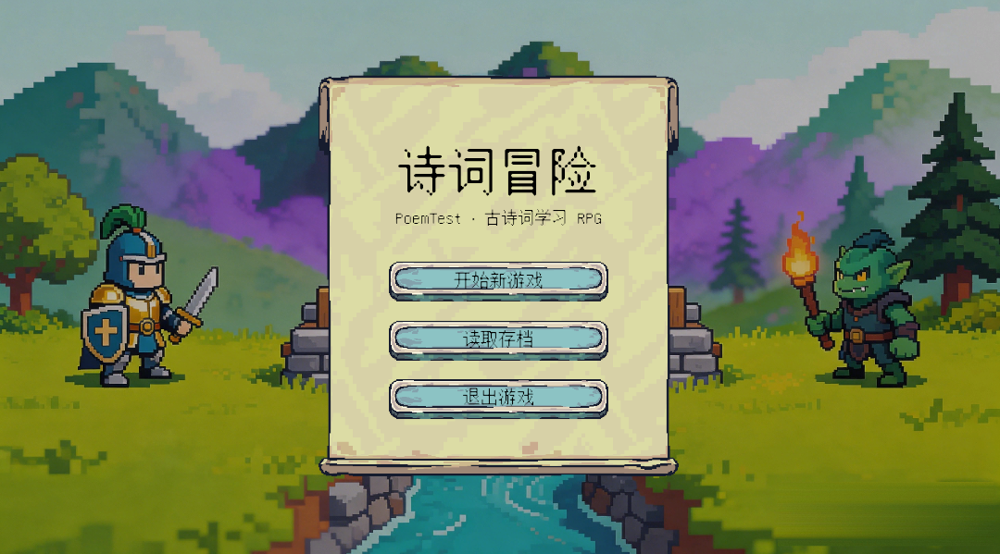<br><sub><b>Title screen</b> · cover art, scroll banner, nine-sliced buttons</sub></td>
    <td width="50%">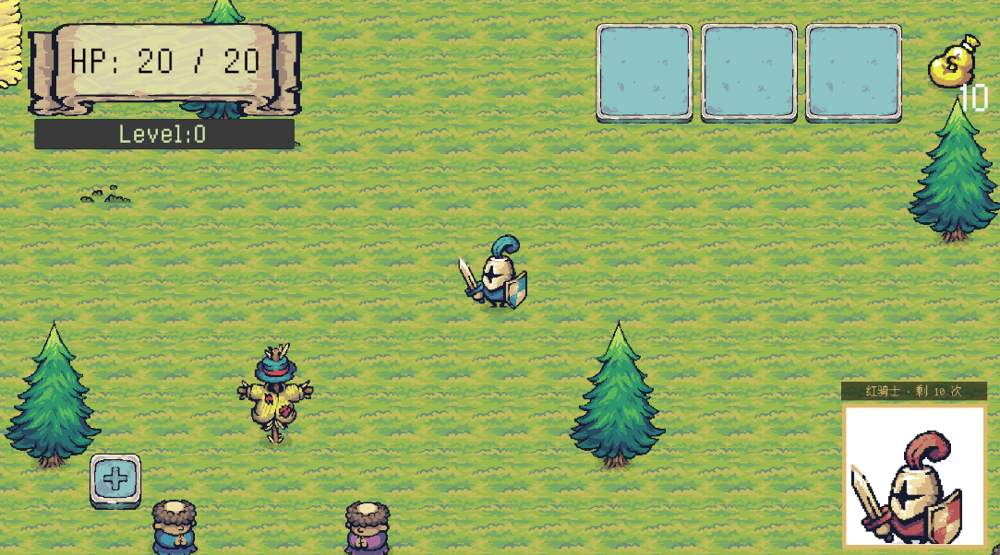<br><sub><b>Exploration</b> · pixel-art world and HUD</sub></td>
  </tr>
  <tr>
    <td>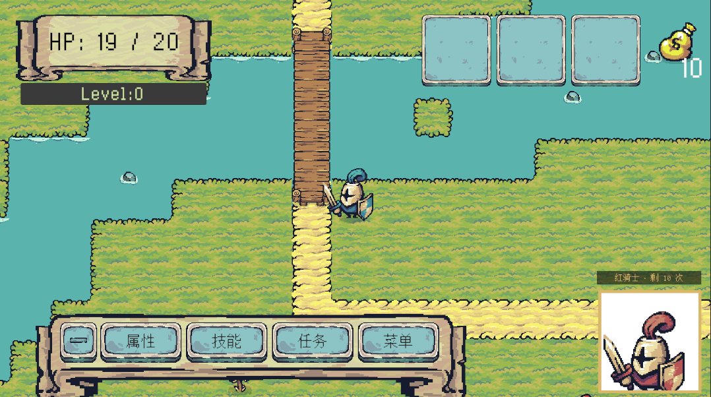<br><sub><b>Bottom-left action bar</b> · Stats / Skills / Quests / Menu side by side</sub></td>
    <td>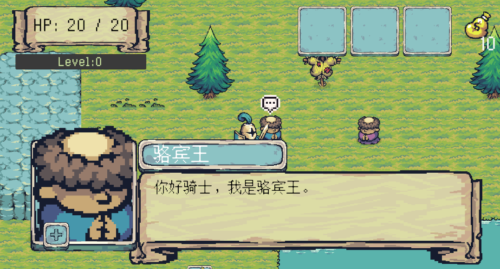<br><sub><b>Poet dialogue</b> · portrait, text and choices</sub></td>
  </tr>
  <tr>
    <td>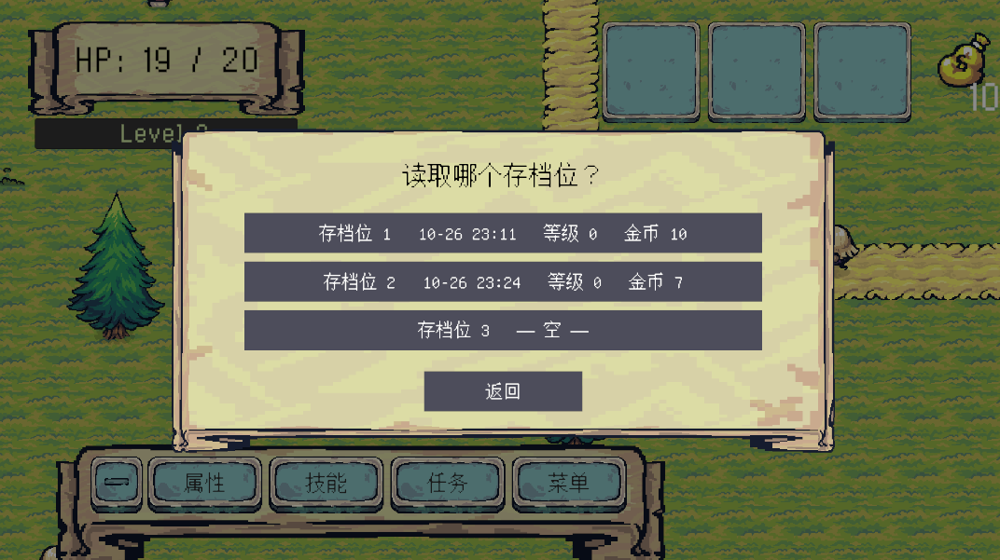<br><sub><b>Save slots</b> · three slots with time / level / gold</sub></td>
    <td>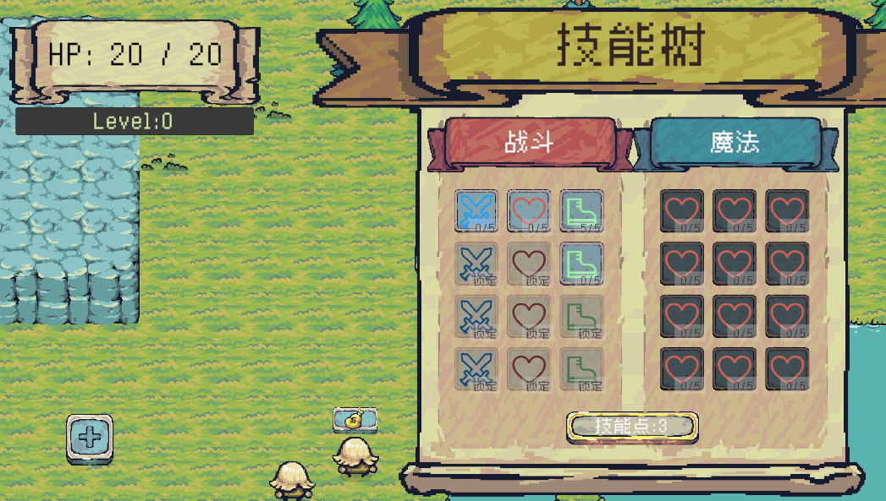<br><sub><b>Skill tree</b> · 24 nodes with prerequisites and point spending</sub></td>
  </tr>
  <tr>
    <td>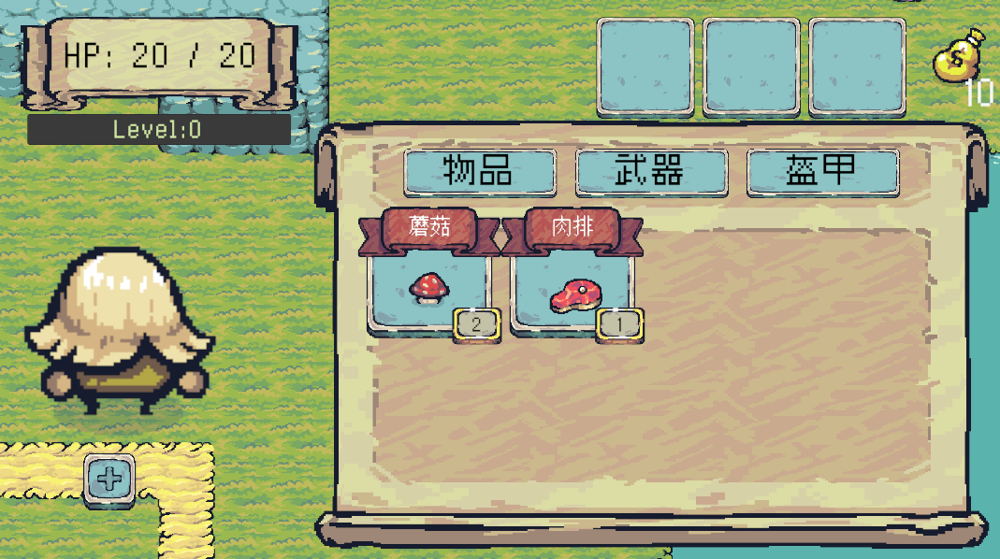<br><sub><b>Shop</b> · tabs for consumables / weapons / armour</sub></td>
    <td>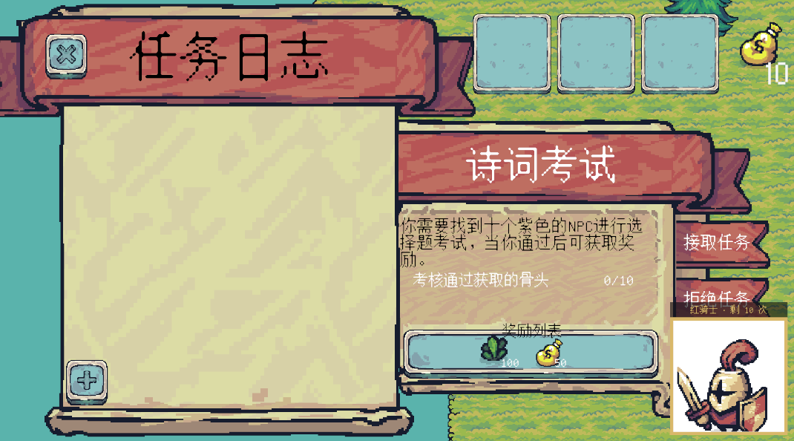<br><sub><b>Quest board</b> · accept / abandon / hand in</sub></td>
  </tr>
</table>

---

## ✨ Features

|     | Feature | Description |
| --- | --- | --- |
| 📚 | **Ten classic poems** | 《咏鹅》《春晓》《池上》《静夜思》《所见》《悯农》《寻隐者不遇》《登鹳雀楼》《风》《小儿垂钓》 — fully data-driven and freely extendable |
| 🤖 | **AI explanations** | Defaults to the **official DeepSeek API** (`deepseek-chat`) with a strict "objective, concise, 150–220 characters, no headings or lists" prompt; also supports both the native and OpenAI-compatible DashScope channels, switchable at runtime |
| 🎨 | **AI illustrations** | Uses Tongyi Wanxiang `wan2.7-image-pro` to generate a 1024×576 classical-style illustration from a per-poem prompt and display it instantly |
| 🏷️ | **Content source badges** | Every piece of content is labelled `Built-in` / `AI generated` / `AI generated · cached` — both informative and a required explicit disclosure for AI-generated content |
| 💾 | **Content cache & offline fallback** | Generated text and images are persisted and reused, so **each poem is only paid for once**; after baking into built-in content the game runs fully offline |
| 🎤 | **Voice recitation exam** | Microphone → 16 kHz PCM → Baidu short-speech recognition → **hanzi-to-pinyin + edit-distance similarity** scoring, so a few misrecognised characters do not immediately fail the player |
| ✅ | **Multiple-choice exam** | Four-option poetry knowledge questions; a correct answer grants a token |
| 🧙 | **AI companion "Red Knight"** | Persistent portrait in the corner supporting **typed questions, spoken questions and spoken answers**; emits structured JSON that drives character animations, with a sprite-sheet idle loop |
| 🗒️ | **Three save slots** | Reachable from the title screen, the `Esc` menu and the slot list; stores position, health, gold, EXP, inventory, quests, **skill levels and spent points**, and passed exams; `F5` quick-save, `F9` quick-load |
| 📜 | **Quest system** | Objectives can be item-, location- or dialogue-based; includes a quest board, quest log and accept / abandon / hand-in flows |
| 🎒 | **Inventory & shop** | Stacking, using, dropping and looting items; a shop with consumable / weapon / armour tabs, buying and selling |
| ⚔️ | **Action combat** | Melee slashing and bow shooting, weapon switching, cooldowns, knockback and stun, visualised hit ranges |
| 📈 | **Progression** | EXP from kills and pickups, multi-level-ups, a 24-node skill tree (attack / health / speed) |
| 🕹️ | **Unified PC & mobile input** | One set of key bindings: keyboard in the editor and on PC, virtual joystick and touch buttons on device; the whole UI is safe-area aware |
| 🗺️ | **Two scenes with persistent state** | Travel freely between two maps; player, UI, inventory and quest progress persist across scenes |
| 💬 | **Data-driven dialogue** | Unlock conditions, branching choices, Q&A checks and quest hooks; lines can embed `{PoemTitle}` `{Poet}` `{PoemContent}` `{SelectedLines}` placeholders |
| 🎛️ | **Visual UI configuration** | The menu UI is a prefab you can edit directly in Unity; styling, sprites, colours and layout values live in a `UIStyleSettings` asset |

---

## 🎮 Gameplay & Content

### Game loop

```
        ┌───────────────── Explore ─────────────────┐
        │  Fight · gather mushrooms/meat · loot gold & EXP
        └────────────────────┬──────────────────────┘
                             │
      ┌──────────────────────┼───────────────────────┐
      ▼                      ▼                       ▼
   Poet NPCs              Examiner NPCs          Coloured NPCs
   (10)                   (10)                   (blue / yellow / purple)
      │                      │                       │
  Poetry dialogue        Voice recitation       Quest dialogue
      │                  (say the next line)     (starter quest chain)
      ├─► Explanation: AI-generated text              │
      │                                        Correct answer → "bone"
      └─► Illustration: AI-generated art               │
                             │                      │
                    Pass → "pumpkin"                 │
                             └───────────┬──────────┘
                                         ▼
                        Hand in at the quest board (10 bones / 10 pumpkins)
                                         ▼
                              Reward: 100 EXP + 50 gold
                                         ▼
                     Level up → skill points → 24-node skill tree
```

### AI illustrations

<p align="center">
  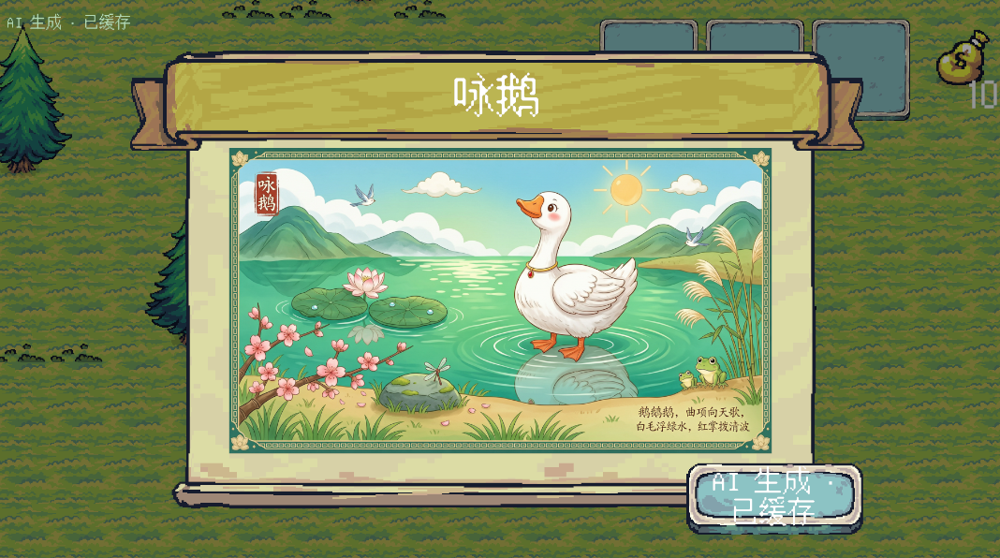
</p>

<p align="center">
  <sub>AI-generated illustration for 《咏鹅》 · the <code>AI generated · cached</code> badges in the corners are the content-source disclosure</sub>
</p>

### Included poems

| # | Title | Author | Famous line |
| :---: | --- | --- | --- |
| 1 | 咏鹅 | 骆宾王 | 白毛浮绿水，红掌拨清波。 |
| 2 | 春晓 | 孟浩然 | 夜来风雨声，花落知多少。 |
| 3 | 池上 | 白居易 | 不解藏踪迹，浮萍一道开。 |
| 4 | 静夜思 | 李白 | 举头望明月，低头思故乡。 |
| 5 | 所见 | 袁枚 | 意欲捕鸣蝉，忽然闭口立。 |
| 6 | 悯农（其二） | 李绅 | 谁知盘中餐，粒粒皆辛苦。 |
| 7 | 寻隐者不遇 | 贾岛 | 只在此山中，云深不知处。 |
| 8 | 登鹳雀楼 | 王之涣 | 欲穷千里目，更上一层楼。 |
| 9 | 风 | 李峤 | 过江千尺浪，入竹万竿斜。 |
| 10 | 小儿垂钓 | 胡令能 | 路人借问遥招手，怕得鱼惊不应人。 |

### NPCs and quests

| Character | Role |
| --- | --- |
| Poet NPC × 10 | One per poem; provides dialogue plus AI explanation and illustration entry points |
| Examiner NPC × 10 | Voice recitation exam; passing grants 1 "pumpkin" |
| Purple NPC | Multiple-choice examiner; a correct answer grants 1 "bone" |
| Blue NPC | Gives and receives starter quest #1 |
| Yellow NPC | Conversation target of starter quest #3 |
| Knight | Combat target |

| Quest | Level | Objective | Reward |
| --- | :---: | --- | --- |
| Starter quest #1 | 1 | Reach the hill + gather 3 mushrooms + return to the blue NPC | 10 EXP, 10 gold, 3 mushrooms |
| Starter quest #2 | 1 | Collect 2 pieces of meat | 10 EXP, 10 gold |
| Starter quest #3 | 1 | Talk to the yellow NPC | — |
| Poetry exam | 10 | Collect 10 bones from the quiz | 100 EXP, 50 gold |
| Recitation exam | 10 | Collect 10 pumpkins from recitations | 100 EXP, 50 gold |

### Controls

| Key | Action | Key | Action |
| :---: | --- | :---: | --- |
| `W A S D` / arrows | Move | `Q` | Stats panel |
| `J` | Melee attack | `E` | Skill tree |
| `K` | Shoot arrow | `Z` | Start / stop recording |
| `V` | Switch melee / bow | `1` `2` `3` | Use item (sell inside the shop) |
| `F` | Interact (dialogue / exam / explanation / illustration / shop / quest board) | `4` `5` `6` | Drop item |
| `Tab` | Open / close the AI companion | `Esc` | Game menu (resume / save / load / title) |
| `F5` | Quick save | `F9` | Quick load |
| `F11` | Model connectivity diagnostics (AI troubleshooting) | — | — |

> No code changes are needed for mobile: `MobileInputManager` automatically enables the virtual joystick
> and touch buttons on device, and hides them in the editor and on PC in favour of the keyboard.

---

## 🧙 AI Companion "Red Knight"

A portrait character permanently anchored in the bottom-right corner — the most AI-dense part of the project.

### Appearance

<p align="center">
  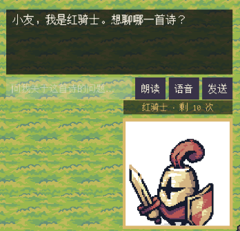
</p>

<p align="center">
  <sub>The Red Knight · upper-body crop plus the remaining question counter</sub>
</p>

- **Portrait frame**: shows the character's upper body, cropped with `RectMask2D`, sized to match the dialogue system's NPC portrait
- **Sprite-sheet animation**: frame-by-frame idle loop
- **Typewriter bubble**: answers are revealed character by character

### Instruction-based protocol

Rather than letting the model free-form, it must answer with structured JSON:

```json
{ "say": "白毛浮绿水，说的是鹅的羽毛浮在水面上。", "action": "nod" }
```

- The persona is a seasoned, well-read **"Red Knight" senior**, speaking like a mentor, in under 40 characters per reply

### Asking by voice

- Unity `Microphone` recording → **runtime resampling** to 16 kHz / 16 bit / mono
- Leading and trailing silence is trimmed; clips that are too short are rejected so no request is wasted
- Uses Baidu short-speech recognition; the transcript is placed into the input field and submitted
- Error codes are translated into human-readable Chinese (bad audio quality / quota exhausted / too short, …)

### Hearing it speak

- Uses Baidu text-to-speech, which returns audio in a single request — no task polling
- Shares one cached `access_token` with speech recognition (`BaiduAuth`)
- A "Read aloud / Mute" toggle is provided; a TTS failure only logs and **never interrupts the text conversation**

### Mutual exclusion with other UI

When dialogue, the poem panels, exams, the skill tree, the stats panel, the shop or the main menu are open,
the companion **automatically hides** and returns afterwards.

> Most of those panels toggle via `CanvasGroup.alpha` rather than deactivation, so the check uses
> `alpha > 0.5` instead of `activeSelf`.

---

## 🖼️ Asset preview

The game uses 2D pixel art; below are some of the assets actually used in the repository.

**Buildings & scenery**

| | | | |
| :---: | :---: | :---: | :---: |
|  |  |  |  |
| Castle | Monastery | Tower | House |

**Combat & item icons**

| | | | |
| :---: | :---: | :---: | :---: |
|  |  |  |  |
| Health | Attack | Speed | Poem appraiser item |

**Character sprites (sprite sheets)**

| | | |
| :---: | :---: | :---: |
|  | 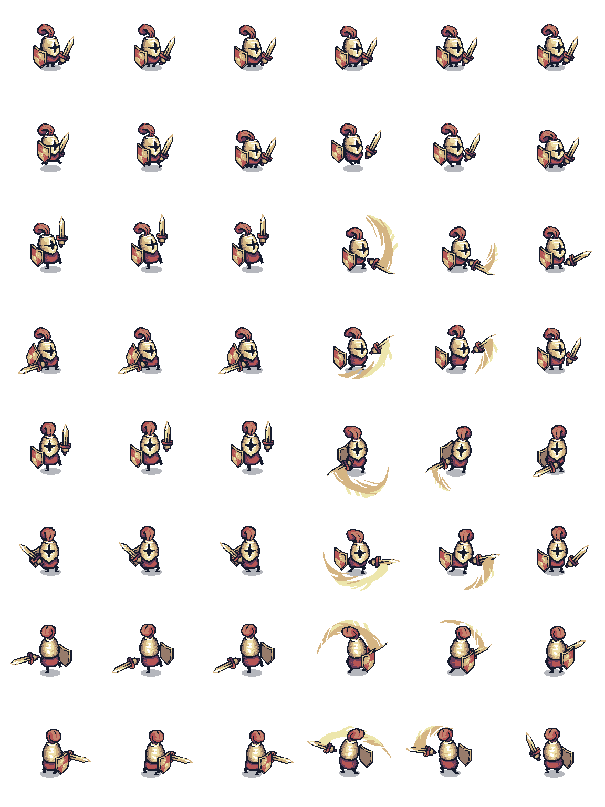 |  |
| Poet NPC | Red Knight (AI companion) | Archer (player) |

> More art lives in `Assets/Sprites/` (terrain, water, trees, buildings, nine-sliced UI, fonts, icons…).

---

## 🛠️ Technical architecture

### Environment and dependencies

| Item | Version |
| --- | --- |
| Unity | 2022.3.60f1c1 (LTS; other 2022.3.x should work) |
| C# | 9.0 (.NET Standard 2.1) |
| Cinemachine | 2.10.7 (2D camera bounds) |
| TextMesh Pro | 3.0.9 (UI text and Chinese font) |
| 2D Feature Set | 2.0.1 (Tilemap / 2D sprites) |
| Input | Legacy Input Manager (Input System package not used) |
| Resolution | 1920 × 1080 |

### Data-driven: everything is a ScriptableObject

| Asset type | Purpose |
| --- | --- |
| `PoemSO` | Poem: title, author, body, AI explanation prompt, AI illustration prompt |
| `ItemSO` | Item: name, icon, stack limit, stat bonuses, consumable flag |
| `ActorSO` | Actor: name, portrait |
| `DialogueSO` | Dialogue node: lines, choices, Q&A checks, quest hooks, display conditions |
| `QuestSO` | Quest: objectives (item / location / dialogue) and rewards |
| `LocationSO` | Location: ID and display name |
| `SkillSO` | Skill: name, max level, per-level increment, icon |

### Event-driven: systems stay decoupled

| Event | Publisher | Subscriber |
| --- | --- | --- |
| `QuestEvents.OnQuestOfferRequested` / `OnQuestTurnInRequested` | `DialogueManager`, `QuestBoard` | `QuestLogUI` |
| `QuestEvents.OnQuestAccepted` | `QuestLogUI` | `NPCTalk`, `PoemTalk` |
| `QuestEvents.IsQuestComplete` | `QuestManager` | `QuestBoard`, `DialogueSO` |
| `EnemyHealth.OnMonsterDefeated` | `EnemyHealth` | `ExpManager` |
| `InventoryManager.OnExperienceGained` | `InventoryManager` | `ExpManager` |
| `Loot.OnItemLooted` | `Loot` | `InventoryManager` |
| `ShopKeeper.OnShopStateChanged` | `ShopKeeper` | `InventorySlot` |
| `SkillSlot.OnAbilityPointSpent` / `OnSkillMaxed` | `SkillSlot` | `SkillManager`, `SkillTreeManager` |

### Main systems

| Module | Directory | Responsibility |
| --- | --- | --- |
| Global | `Scripts/GameManager.cs` | Singletons and cross-scene persistent objects |
| Input | `Scripts/MobileScript/` | Unified PC / mobile input abstraction |
| Player | `Scripts/Player/` | Movement, melee, bow, health, stats, EXP, death and respawn |
| Enemies | `Scripts/Enemy/` | State-machine AI (idle / chase / attack / knockback), health, hit-stun |
| Poetry | `Scripts/PoemScripts/` | Poem data, AI explanation and illustration, multi-channel fallback, content cache, source badges, recitation examiner |
| **AI companion** | `Scripts/Assistant/` | Portrait and animation, instruction-based dialogue protocol, speech recognition, text-to-speech, shared Baidu token |
| **UI toolkit** | `Scripts/UI/` | Code-driven UI factory, global style, menu prefab, safe-area fitting |
| **Save system** | `Scripts/Save/` | Three-slot JSON saves, world state, skill and exam persistence |
| Voice | `Scripts/Voice/` | Recording, ASR requests, voice interaction UI |
| Dialogue | `Scripts/NPCScript/` | NPC state machines, dialogue system, history |
| Quests | `Scripts/QuestSystem/` | Quest manager, quest log UI, quest board |
| Inventory & shop | `Scripts/Inventory&Shop/` | Inventory, items, loot, shop and item info |
| Skill tree | `Scripts/SkillTree/` | Skill data, slots, prerequisites and point spending |
| UI | `Scripts/UIScripts/` | Menu management, ref-counted pause control |
| Camera / tilemap / scenes | `Scripts/CameraScripts/`, `Scripts/TilemapScripts/`, `Scripts/SceneChange/` | 2D camera bounds, height-based collision switching, scene transitions |
| Pinyin utility | `Scripts/Plugins/NPinyin/` | Hanzi-to-pinyin (third-party) |

### Directory layout

```
poemTest/
├── Assets/
│   ├── Editor/                  Editor tooling (data init, content baking, menu prefab)
│   ├── Prefabs/                 Prefabs (NPCs, player, UI, loot)
│   ├── Resources/
│   │   ├── UIStyleSettings.asset    UI style, sprites and layout (Inspector-editable)
│   │   ├── GameMenuCanvas.prefab    Menu UI prefab (editable directly in Unity)
│   │   ├── GameDatabase.asset       Asset index
│   │   ├── api_keys.example.json    Key template (copy to api_keys.json)
│   │   └── tt.png                   Title screen cover
│   ├── Scenes/                  RPG1.unity / RPG2.unity
│   ├── Scripts/                 All gameplay scripts (see the table above)
│   ├── Sprites/                 Art assets
│   ├── _PoemContentSource/      AI-generated poem content (can be baked in)
│   └── TextMesh Pro/            Bundled TMP resources
├── Backups/                     Automatic backups before regenerating the menu prefab
├── Packages/manifest.json
├── ProjectSettings/
├── README.md / README.en.md
└── SECURITY.md                  Security notes
```

---

## 🚀 Quick start

### 1. Requirements

- Unity Hub + **Unity 2022.3.60f1c1** (or another 2022.3.x)
- At least 5 GB of free disk space (the first `Library` import is large)

### 2. Run the project

```bash
git clone <this repository>
cd poemTest
```

1. Unity Hub → `Add` → select the repository root;
2. Wait for the first import and package restore;
3. Open `Assets/Scenes/RPG1.unity`;
4. Press **Play**.

Both scenes are already registered in Build Settings and can be built directly.

### 3. Configure API keys (needed for AI and speech)

For security reasons the project **ships no keys**:

```bash
cp Assets/Resources/api_keys.example.json Assets/Resources/api_keys.json
```

```json
{
  "qwenTextKey": "DashScope text key (fallback channel, optional)",
  "qwenImageKey": "DashScope text-to-image key (poem illustrations)",
  "baiduApiKey": "Baidu Cloud speech API key (ASR + TTS)",
  "baiduSecretKey": "Baidu Cloud speech secret key",
  "deepseekKey": "Official DeepSeek API key (explanations + companion chat)"
}
```

> Only `deepseekKey` is required for explanations and the companion; fill `qwenImageKey` for AI illustrations
> and the two Baidu keys for speech.

Environment variables are also supported:

| Variable | Key |
| --- | --- |
| `POEMTEST_DEEPSEEK_KEY` | DeepSeek official (explanations + companion) |
| `POEMTEST_QWEN_TEXT_KEY` | DashScope text generation (fallback) |
| `POEMTEST_QWEN_IMAGE_KEY` | DashScope text-to-image |
| `POEMTEST_BAIDU_API_KEY` | Baidu speech API key |
| `POEMTEST_BAIDU_SECRET_KEY` | Baidu speech secret key |

### 4. Build notes

- **Android**: set the package name, switch the scripting backend to **IL2CPP**, enable **ARM64**, and verify
  that `RECORD_AUDIO` ends up in the manifest — `Microphone` needs it;
- Speech features require network access to `aip.baidubce.com`, `vop.baidu.com` and `tsn.baidu.com`;
- `Assets/Resources/api_keys.json` is bundled into the APK as-is, so it can be extracted — see
  [SECURITY.md](SECURITY.md) before distributing a build;
- To slim the package you can delete `Assets/TextMesh Pro/Examples & Extras`.

---

## 🧰 Editor tools

Menu bar → `Tools → 诗词数据`:

| Menu | Purpose |
| --- | --- |
| `0. Create UI settings asset` | Generates `UIStyleSettings.asset` and picks a Chinese font and companion portrait |
| `1. Fill asset IDs` | Assigns stable IDs to all ScriptableObjects based on file names |
| `2. Build index` | Generates `GameDatabase.asset` (ID → asset lookup) |
| `3. Check duplicates` | Detects ID collisions |
| `Export ID list` | Dumps an ID listing for troubleshooting |
| `4. Bake built-in content` | Writes `_PoemContentSource/` text and images into `PoemSO` |
| `6. Pick an AI companion portrait` | Chooses the companion sprite from the project |
| `7. Load companion sprite frames` | Loads idle animation frames from a sprite sheet |
| `8. Generate menu UI prefab` | Generates `Resources/GameMenuCanvas.prefab` (**overwrites**, with automatic backup to `Backups/`) |
| `9. Configure menu sprites` | Fills in banners, buttons and cover art automatically |

### Where to tweak the UI

| What | Where |
| --- | --- |
| Menu position / size | `Assets/Resources/GameMenuCanvas.prefab` (double-click into prefab mode; runtime code never overrides layout) |
| Colours / fonts / sprites / layout values | `Assets/Resources/UIStyleSettings.asset` (Inspector) |
| Companion appearance and model | `UIStyleSettings.asset` → "AI 助手" section |
| Menu wording | `Assets/Scripts/UI/GameMenuUI.cs` |

---

## ❓ FAQ

**Q: Can I play without any API keys?**

Yes. Exploration, combat, gathering, quests, inventory, shop, skill tree and the multiple-choice exam all
work offline. Only AI explanations, AI illustrations and speech features will report missing keys.

**Q: "AI key not configured" — what now?**

Follow "Quick start → Configure API keys" to create `Assets/Resources/api_keys.json`, or set the matching
environment variables and restart Unity.

**Q: Speech recognition keeps failing?**

Check, in order: whether microphone permission is granted → whether the system detects an input device →
whether `baiduApiKey` / `baiduSecretKey` are correct → whether the device can reach `vop.baidu.com`.
The recording sample rate is fixed at 16000 Hz, matching Baidu's requirement.

**Q: The virtual joystick is missing in the editor.**

That is intentional. The joystick and touch buttons are only enabled on device (non-`UNITY_STANDALONE`
builds); the editor and PC hide them and use the keyboard instead.

**Q: Chinese text or comments render as garbled characters?**

All C# scripts in the project are saved as **UTF-8 with BOM**, and `.gitignore` contains the full Unity rule
set. If a few files still look garbled, check your editor or Git encoding settings — do not re-save the
scripts as GBK.

---

## 🗺️ Roadmap

**To do**

- [ ] **Skill tree differentiation**: all 25 nodes currently share the same effect definitions (health / attack / speed) and need splitting by design intent
- [ ] **Stats panel**: crit rate, defence, dodge, mana and block are still placeholders
- [ ] **On-device mobile verification**: multi-touch joystick handling, recording sample rates and safe area need real-device testing
- [ ] **Content expansion**: more poems and more question types (fill-in-the-blank, matching)

---

## 📄 License & credits

For licensing of the code, please refer to the licence statement in the repository root.

| Asset | Location | Licence |
| --- | --- | --- |
| NPinyin (hanzi to pinyin) | `Assets/Scripts/Plugins/NPinyin/` | See the original project |
| Tiny Speech Indicators (@rehhouari / @pigeonivy) | `Assets/Sprites/UI/Tiny/` | CC0 |
| TextMesh Pro | `Assets/TextMesh Pro/` | Unity Companion License |
| Cinemachine | `Packages/manifest.json` | Unity Companion License |
| Fonts `zpix SDF`, `unifont-17.0` | `Assets/Sprites/Fonts/` | Verify each licence before release |
| Remaining pixel art | `Assets/Sprites/` | Verify origin and licence before release |

> If you intend to use this commercially, please verify the licence of every asset listed above.

---

## 📚 Related documents

- [README.md](README.md) — 中文说明
- [SECURITY.md](SECURITY.md) — key management and security notes (**read this first**)
