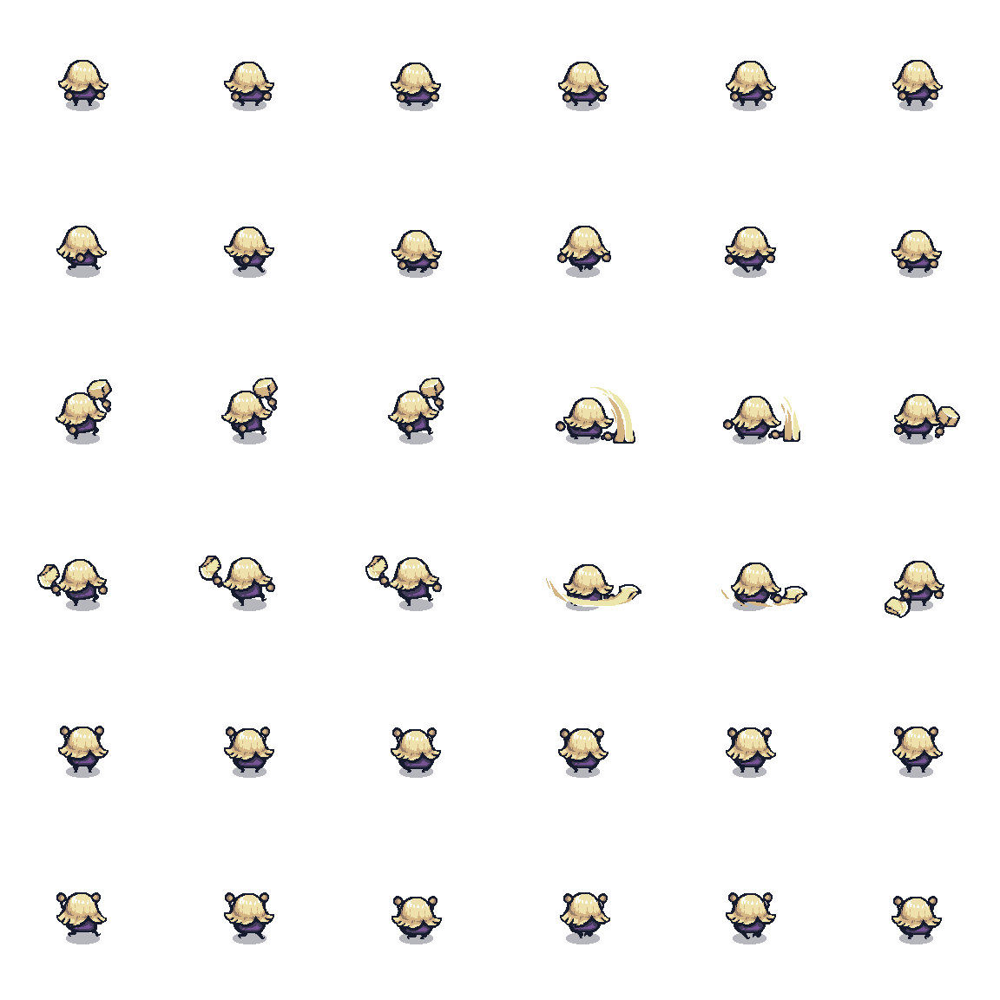
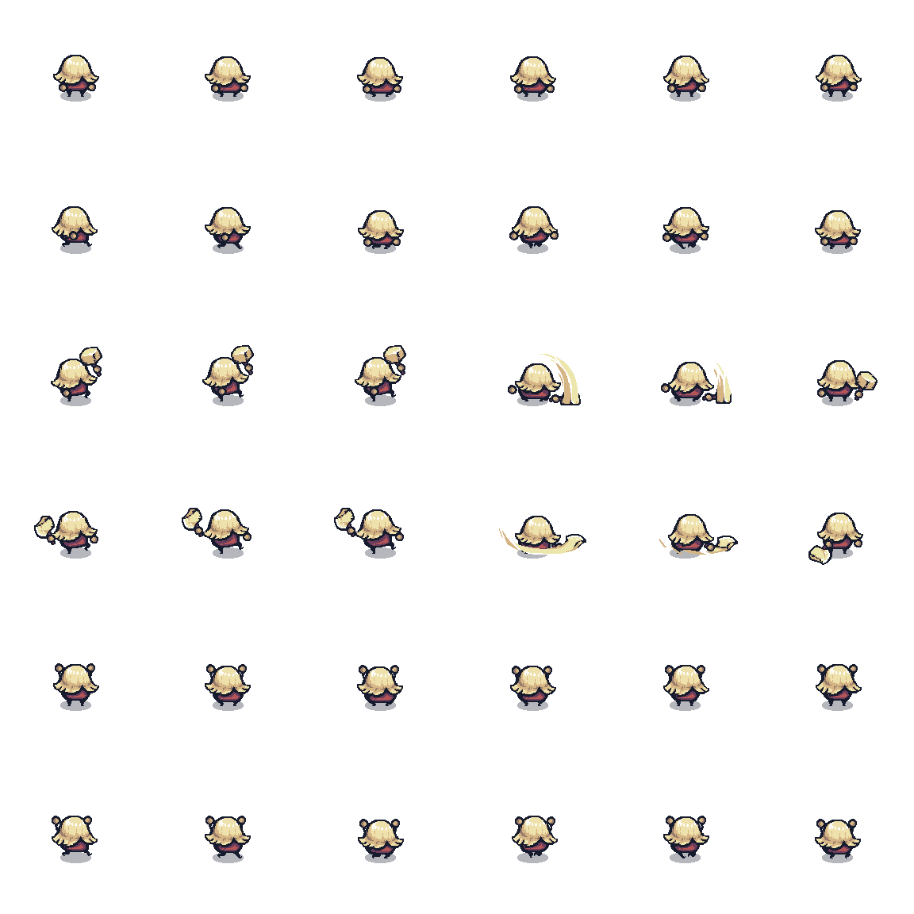
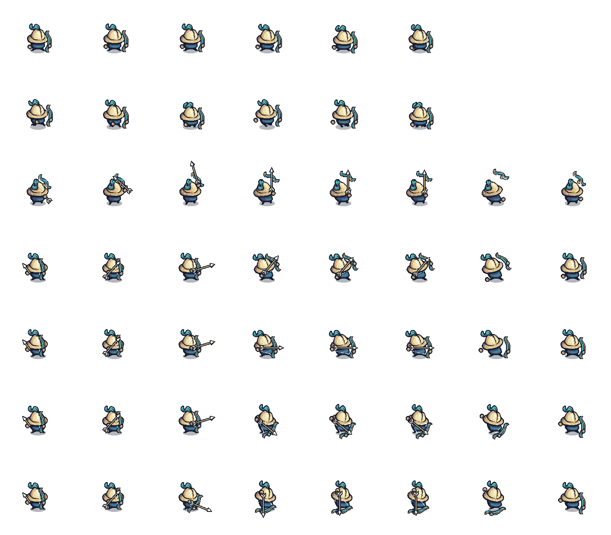

# 诗词冒险 · PoemTest

> 一个把**古诗词学习**做进 **2D 像素 RPG** 的 Unity 项目：
> 边探索边读诗，AI 帮你读懂，开口背给你听。

**引擎**：Unity 2022.3.60f1c1（LTS） · **语言**：C# 9.0 · **平台**：Windows / Android · **视角**：2D 俯视像素风

---

## 📖 项目简介

《诗词冒险》是一款面向 K12 语文启蒙的 2D 像素风角色扮演游戏。玩家扮演一名小勇士，在两张开放地图上探索、战斗、采集，沿途拜访**十位诗人 NPC**，逐一学习十首经典古诗。

与常见的「点开卡片读注释」不同，这款游戏把 **AI 与语音技术** 真正接进了学习闭环：

- 想读懂一首诗？直接在游戏里问 AI，**通义千问**当场给出 200–300 字的客观释义；
- 想看见诗里的画面？**通义万相**根据诗意实时生成一张古风插画；
- 学完了要检验？走到考官面前**开口背出下一句**，游戏用**百度语音识别 + 拼音相似度比对**给你打分；
- 也可以选择做**四选一选择题**，答对获得信物。

攒够信物后回到任务板交付，拿到经验与金币，升级后把技能点投进技能树。读诗 → 懂诗 → 背诗 → 得奖励，形成一个完整、可玩、有正反馈的学习循环。

整个项目的内容全部由 **ScriptableObject 数据驱动**——诗词、物品、对话、任务、角色、地点、技能都是可以在 Inspector 里直接编辑的资源配置文件，方便老师或策划在不改一行代码的前提下扩展课程内容。

---

## ✨ 功能特性

| | 特性 | 说明 |
|---|---|---|
| 📚 | **十首经典古诗** | 《咏鹅》《春晓》《池上》《静夜思》《所见》《悯农》《寻隐者不遇》《登鹳雀楼》《风》《小儿垂钓》，全部数据化，可自由增删 |
| 🤖 | **AI 实时释义** | 接入阿里云百炼 · 通义千问 `qwen-turbo`，按「客观、简洁、200–300 字、不分标题不列表」的提示词规范生成释义 |
| 🎨 | **AI 实时配图** | 接入通义万相 `wan2.6-t2i`，由诗词专属提示词生成 1024×576 古风插画并即时贴到画布上 |
| 🎤 | **语音背诵考试** | 麦克风采集 16 kHz PCM → 百度短语音识别 → **汉字转拼音 + 编辑距离相似度**判分，个别字听错也不会直接判负 |
| ✅ | **选择题考试** | 四选一诗词常识题（如「《池上》中小孩子偷偷采摘的是什么？」），答对获得信物 |
| 📜 | **完整任务系统** | 目标支持**物品 / 地点 / 对话**三种判定方式；含任务板、任务日志、接受/放弃/交付流程 |
| 🎒 | **背包与商店** | 物品堆叠、使用、丢弃、掉落；商店支持分页签（道具/武器/护甲）、购买与出售 |
| ⚔️ | **动作战斗** | 近战挥砍与弓箭射击双武器切换、冷却、击退与硬直、命中范围可视化 |
| 📈 | **成长系统** | 击杀与道具获得经验、连续升级、24 节点技能树（攻击 / 生命 / 速度） |
| 🕹️ | **PC 与移动端统一输入** | 同一套键位逻辑：编辑器/PC 用键盘，真机自动切换为虚拟摇杆 + 触摸按钮 |
| 🗺️ | **双场景与存档式持久化** | 两张地图自由往返，玩家、UI、背包、任务进度跨场景保留 |
| 💬 | **数据驱动对话系统** | 支持条件解锁、选项分支、问答判定、任务挂接，台词里可用 `{PoemTitle}` `{Poet}` `{PoemContent}` `{SelectedLines}` 占位符自动注入诗词内容 |

---

## 🎮 玩法与内容

### 游戏流程

```
        ┌───────────────── 探索 ─────────────────┐
        │  打怪 · 采集蘑菇/肉排 · 拾取金币与经验        │
        └────────────────────┬──────────────────┘
                             │
      ┌──────────────────────┼───────────────────────┐
      ▼                      ▼                       ▼
   诗人 NPC               考官 NPC                彩色 NPC
   （10 位）              （10 位）            （蓝 / 黄 / 紫）
      │                      │                       │
   诗词对话              语音背诵考试             任务对话
      │                 （说出下一句）           （新手任务链）
      ├─► 解读：AI 生成诗词释义                       │
      │                                       答对得「骨头」
      └─► 配图：AI 生成古风插画                       │
                             │                      │
                       通过得「南瓜」                 │
                             └───────────┬──────────┘
                                         ▼
                          任务板交付（10 骨头 / 10 南瓜）
                                         ▼
                              奖励：100 经验 + 50 金币
                                         ▼
                            升级 → 技能点 → 24 节点技能树
```

### 收录古诗

| 编号 | 诗名 | 作者 | 名句 |
| :---: | --- | --- | --- |
| 1 | 咏鹅 | 骆宾王 | 白毛浮绿水，红掌拨清波。 |
| 2 | 春晓 | 孟浩然 | 夜来风雨声，花落知多少。 |
| 3 | 池上 | 白居易 | 不解藏踪迹，浮萍一道开。 |
| 4 | 静夜思 | 李白 | 举头望明月，低头思故乡。 |
| 5 | 所见 | 袁枚 | 意欲捕鸣蝉，忽然闭口立。 |
| 6 | 悯农（其二） | 李绅 | 谁知盘中餐，粒粒皆辛苦。 |
| 7 | 寻隐者不遇 | 贾岛 | 只在此山中，云深不知处。 |
| 8 | 登鹳雀楼 | 王之涣 | 欲穷千里目，更上一层楼。 |
| 9 | 风 | 李峤 | 过江千尺浪，入竹万竿斜。 |
| 10 | 小儿垂钓 | 胡令能 | 路人借问遥招手，怕得鱼惊不应人。 |

### NPC 与任务

| 角色 | 职责 |
| --- | --- |
| 诗人 NPC × 10 | 一人对应一首诗，提供对话、AI 解读、AI 配图入口 |
| 考官 NPC × 10 | 语音背诵考试，通过奖励 1 个「南瓜」 |
| 紫色 NPC | 选择题考官，答对奖励 1 根「骨头」 |
| 蓝色 NPC | 新手任务（一）发布者与交付对象 |
| 黄色 NPC | 新手任务（三）的交谈目标 |
| 骑士 | 战斗目标 |

| 任务 | 等级 | 目标 | 奖励 |
| --- | :---: | --- | --- |
| 新手任务（一） | 1 | 到达山上 + 采集 3 个蘑菇 + 回到蓝色 NPC 处 | 10 经验、10 金币、3 蘑菇 |
| 新手任务（二） | 1 | 收集 2 个肉排 | 10 经验、10 金币 |
| 新手任务（三） | 1 | 与黄色 NPC 交谈 | — |
| 诗词考试 | 10 | 选择题考试累计 10 根骨头 | 100 经验、50 金币 |
| 拼读考试 | 10 | 语音背诵考核累计 10 个南瓜 | 100 经验、50 金币 |

### 操作说明

| 按键 | 功能 | 按键 | 功能 |
| :---: | --- | :---: | --- |
| `W A S D` / 方向键 | 移动 | `Q` | 属性面板 |
| `J` | 近战攻击 | `E` | 技能树 |
| `K` | 射箭 | `Z` | 开始 / 停止录音 |
| `V` | 切换近战 / 弓箭 | `1` `2` `3` | 使用物品（商店内为出售） |
| `F` | 交互（对话 / 考试 / 解读 / 配图 / 商店 / 任务板） | `4` `5` `6` | 丢弃物品 |

> 移动端无需改代码：`MobileInputManager` 会在真机上自动启用虚拟摇杆与触摸按钮，在编辑器与 PC 上自动隐藏本套 UI 并切换为键盘操作。

---

## 🖼️ 素材预览

游戏使用 2D 像素美术，以下为仓库内实际使用的部分素材：

**建筑与场景**

| | | | |
| :---: | :---: | :---: | :---: |
|  |  |  |  |
| 城堡 | 修道院 | 塔楼 | 民居 |

**战斗与道具图标**

| | | | |
| :---: | :---: | :---: | :---: |
|  |  |  |  |
| 生命 | 攻击 | 速度 | 诗词解读道具 |

**角色精灵图（序列帧）**

| | | |
| :---: | :---: | :---: |
|  |  |  |
| 诗人 NPC | 考官 NPC | 弓箭手（玩家） |

> 更多美术资源见 `Assets/Sprites/`（地形、水面、树木、房屋、UI 九宫格、字体、图标等）。

---

## 🛠️ 技术架构

### 环境与依赖

| 项 | 版本 |
| --- | --- |
| Unity | 2022.3.60f1c1（LTS，同系列 2022.3.x 亦可） |
| C# | 9.0（.NET Standard 2.1） |
| Cinemachine | 2.10.7（2D 相机边界跟随） |
| TextMesh Pro | 3.0.9（UI 文本与中文字体） |
| 2D Feature Set | 2.0.1（Tilemap / 2D 精灵） |
| 输入系统 | 旧版 Input Manager（未使用 Input System 包） |
| 分辨率 | 1920 × 1080 |

### 数据驱动：一切内容都是 ScriptableObject

| 资源类型 | 作用 |
| --- | --- |
| `PoemSO` | 诗词：标题、作者、正文、AI 释义提示词、AI 配图提示词 |
| `ItemSO` | 物品：名称、图标、堆叠上限、属性加成、是否可消耗 |
| `ActorSO` | 角色：名称、立绘 |
| `DialogueSO` | 对话节点：台词数组、选项、问答判定、任务挂接、显示条件 |
| `QuestSO` | 任务：目标列表（物品/地点/对话三类）、奖励列表 |
| `LocationSO` | 地点：ID、显示名 |
| `SkillSO` | 技能：名称、等级上限、每级增量、图标 |

### 事件驱动：系统之间零硬引用

| 事件 | 发布者 | 订阅者 |
| --- | --- | --- |
| `QuestEvents.OnQuestOfferRequested` / `OnQuestTurnInRequested` | `DialogueManager`、`QuestBoard` | `QuestLogUI` |
| `QuestEvents.OnQuestAccepted` | `QuestLogUI` | `NPCTalk`、`PoemTalk`（移除已发放的任务对话） |
| `QuestEvents.IsQuestComplete` | `QuestManager` | `QuestBoard`、`DialogueSO` |
| `EnemyHealth.OnMonsterDefeated` | `EnemyHealth` | `ExpManager` |
| `InventoryManager.OnExperienceGained` | `InventoryManager` | `ExpManager` |
| `Loot.OnItemLooted` | `Loot` | `InventoryManager` |
| `ShopKeeper.OnShopStateChanged` | `ShopKeeper` | `InventorySlot`（决定按键是「使用」还是「出售」） |
| `SkillSlot.OnAbilityPointSpent` / `OnSkillMaxed` | `SkillSlot` | `SkillManager`（结算属性）、`SkillTreeManager`（扣点与解锁） |

### 主要系统

| 模块 | 目录 | 职责 |
| --- | --- | --- |
| 全局管理 | `Scripts/GameManager.cs` | 单例、跨场景持久化对象注册 |
| 输入 | `Scripts/MobileScript/` | PC / 移动端统一输入抽象 |
| 玩家 | `Scripts/Player/` | 移动、近战、弓箭、血量、属性、经验、死亡复活 |
| 敌人 | `Scripts/Enemy/` | 状态机 AI（待机/追击/攻击/击退）、血量、硬直 |
| 诗词 | `Scripts/PoemScripts/` | 诗词数据、AI 释义与配图、语音背诵考官 |
| 语音 | `Scripts/Voice/` | 录音、ASR 请求、语音交互 UI |
| 对话 | `Scripts/NPCScript/` | NPC 状态机（巡逻/游走/交谈）、对话系统、历史记录 |
| 任务 | `Scripts/QuestSystem/` | 任务管理、任务日志 UI、任务板 |
| 背包商店 | `Scripts/Inventory&Shop/` | 背包、物品、掉落、使用、商店与物品信息面板 |
| 技能树 | `Scripts/SkillTree/` | 技能数据、技能槽、前置解锁与加点结算 |
| UI | `Scripts/UIScripts/` | 菜单管理、统一暂停控制 |
| 相机 / 地形 / 切场景 | `Scripts/CameraScripts/`、`Scripts/TilemapScripts/`、`Scripts/SceneChange/` | 2D 相机边界、高低差碰撞切换、场景过渡 |
| 拼音工具 | `Scripts/Plugins/NPinyin/` | 汉字转拼音（第三方库） |

### 目录结构

```
poemTest/
├── Assets/
│   ├── Prefabs/                 预制体（NPC、玩家、UI、掉落物）
│   ├── Resources/               api_keys.example.json 密钥模板
│   ├── Scenes/                  RPG1.unity 主场景 / RPG2.unity 第二场景
│   ├── Scripts/                 全部游戏脚本（见上表）
│   ├── Sprites/                 美术资源
│   └── TextMesh Pro/            TMP 内置资源
├── Packages/manifest.json
├── ProjectSettings/
├── docs/                        开发记录与文档
├── README.md / README.en.md
└── SECURITY.md                  安全说明
```

---

## 🚀 快速开始

### 1. 环境要求

- Unity Hub + **Unity 2022.3.60f1c1**（或同系列 2022.3.x）
- 磁盘空间建议预留 5 GB 以上（首次导入 Library 会较大）

### 2. 运行项目

```bash
git clone <本仓库地址>
cd poemTest
```

1. 打开 Unity Hub → `Add` → 选择仓库根目录；
2. 等待首次资源导入与包还原完成；
3. 打开 `Assets/Scenes/RPG1.unity`；
4. 点击 **Play**。

两个场景已登记在 `Build Settings` 中，可直接打包。

### 3. 配置 API 密钥（使用 AI 与语音功能时需要）

出于安全考虑，项目**不包含任何密钥**，密钥需要你自己配置：

```bash
# 复制模板
cp Assets/Resources/api_keys.example.json Assets/Resources/api_keys.json
```

然后填入自己的密钥：

```json
{
  "qwenTextKey": "阿里云百炼文本生成 API Key（诗词释义）",
  "qwenImageKey": "阿里云百炼文生图 API Key（诗词配图）",
  "baiduApiKey": "百度智能云语音识别 API Key",
  "baiduSecretKey": "百度智能云语音识别 Secret Key"
}
```

也可以改用环境变量（便于 CI 或本地多环境切换）：

| 环境变量 | 对应密钥 |
| --- | --- |
| `POEMTEST_QWEN_TEXT_KEY` | 通义千问文本生成 |
| `POEMTEST_QWEN_IMAGE_KEY` | 通义万相文生图 |
| `POEMTEST_BAIDU_API_KEY` | 百度语音识别 API Key |
| `POEMTEST_BAIDU_SECRET_KEY` | 百度语音识别 Secret Key |

> `Assets/Resources/api_keys.json` 已加入 `.gitignore`，不会被提交。
> 读取逻辑见 `Assets/Scripts/Config/ApiKeyConfig.cs`。

### 4. 打包注意

- **Android**：在 `Player Settings` 中开启麦克风权限，并在真机上验证录音设备枚举；
- 语音功能依赖网络，需确保设备可访问百度语音识别接口；
- 如需移除示例资源以减小包体，可删除 `Assets/TextMesh Pro/Examples & Extras`。

---

## ❓ 常见问题

**Q：没有配置 API 密钥能玩吗？**

可以。探索、战斗、采集、任务、背包商店、技能树、选择题考试等全部功能都不依赖网络。
只有「AI 释义」「AI 配图」「语音背诵判分」会提示未配置密钥。

**Q：提示「尚未配置 AI 密钥」怎么办？**

按「快速开始 → 配置 API 密钥」创建 `Assets/Resources/api_keys.json` 并填写，
或设置对应的环境变量后重启 Unity。

**Q：语音识别一直失败？**

依次检查：麦克风权限是否授予 → 系统是否检测到输入设备 → `baiduApiKey` / `baiduSecretKey` 是否正确 →
设备网络是否能访问 `vop.baidu.com`。录音采样率固定为 16000 Hz，与百度接口要求一致。

**Q：编辑器里看不到虚拟摇杆？**

这是刻意设计。虚拟摇杆与触摸按钮仅在真机（非 `UNITY_STANDALONE`）构建时启用，
编辑器与 PC 平台自动隐藏并使用键盘操作。

**Q：中文显示或注释乱码？**

项目内所有 C# 脚本已统一为 **UTF-8 with BOM** 编码，并把 `.gitignore` 补全为完整的 Unity 忽略规则。
若仍有个别文件乱码，请检查编辑器或 Git 的编码设置，不要将脚本另存为 GBK。

---

## 🗺️ 待完善

项目主体玩法已经跑通，以下是仍在推进的部分，欢迎一起完善：

- [ ] **技能树内容分配**：24 个节点目前都指向同一个技能，需要按设计意图分配为攻击 / 生命 / 速度三类
- [ ] **属性面板**：暴击率、防御、闪避率、法力值、格挡率等数值尚未实现，当前为占位显示
- [ ] **存档系统**：金币、背包、任务进度、技能点目前仅存在于运行时内存，退出即重置
- [ ] **移动端真机适配**：虚拟摇杆的多点触控手势归属需要真机验证
- [ ] **资源整理**：清理开发期的测试资源，并将 `TextMesh Pro/Examples & Extras` 从包体中移除
- [ ] **内容扩展**：接入更多古诗、更多题型（如填空、连线）

---

## 🤝 参与贡献

1. Fork 本仓库
2. 新建 `Feat_xxx` 分支
3. 提交改动
4. 新建 Pull Request

**提交前请务必自查，不要把密钥提交进仓库：**

```bash
git grep -nE "sk-[A-Za-z0-9]{16,}"
```

也欢迎通过 Issue 反馈 Bug 或提出新的诗词玩法建议。

---

## 📄 许可证与致谢

代码部分请以仓库根目录的授权说明为准。

| 资源 | 位置 | 许可 |
| --- | --- | --- |
| NPinyin（汉字转拼音） | `Assets/Scripts/Plugins/NPinyin/` | 详见原项目声明 |
| Tiny Speech Indicators（@rehhouari / @pigeonivy） | `Assets/Sprites/UI/Tiny/` | CC0 |
| TextMesh Pro | `Assets/TextMesh Pro/` | Unity Companion License |
| Cinemachine | `Packages/manifest.json` | Unity Companion License |
| 字体 `zpix SDF`、`unifont-17.0` | `Assets/Sprites/Fonts/` | 发布前请核实各自授权 |
| 其余像素素材 | `Assets/Sprites/` | 发布前请确认来源与授权 |

> 如需商用，请逐一核实上述素材的授权范围。

---

## 📚 相关文档

- [README.en.md](README.en.md) — English introduction
- [SECURITY.md](SECURITY.md) — 密钥管理与安全须知（**请先阅读**）
- [docs/开发记录与修复清单.md](docs/开发记录与修复清单.md) — 架构细节、修复记录与验证方式
